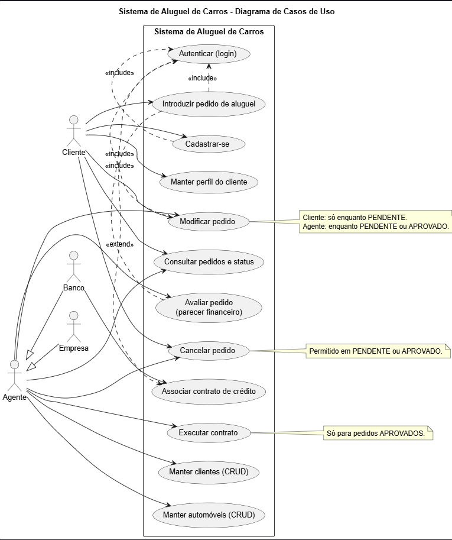
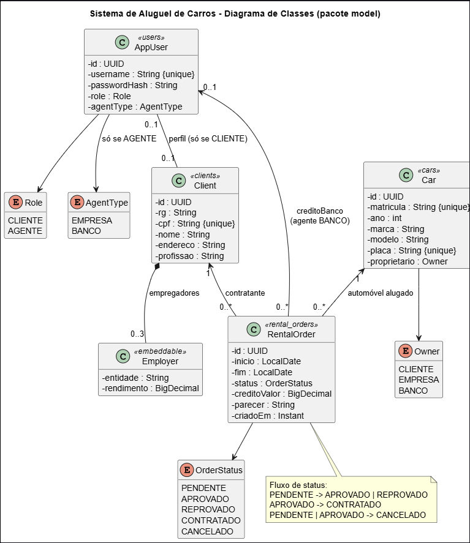
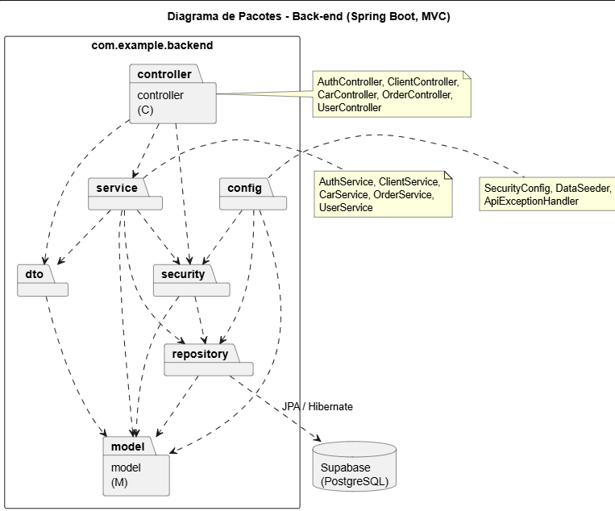

# 🚗 Sistema de Aluguel de Carros (Vitour)

> [!NOTE]
> Sistema web para gestão de aluguéis de automóveis: clientes **introduzem, modificam, consultam e cancelam** pedidos pela Internet, e agentes (bancos e empresas) **avaliam financeiramente** os pedidos e executam o contrato.

<!-- TODO: adicionar a logo do projeto, por exemplo:  -->


> [!TIP]
> **Quer só avaliar o sistema?** Veja o [Modo 2](#modo-2-sistema-completo-com-o-perfil-dev-sem-supabase): roda o front-end e o back-end completos sem configurar banco nem variáveis de ambiente.

---

## 🚧 Status do Projeto

        

---

## 📚 Índice
- [Links Úteis](#-links-úteis)
- [Sobre o Projeto](#-sobre-o-projeto)
- [Funcionalidades Principais](#-funcionalidades-principais)
- [Regras de Negócio](#-regras-de-negócio)
- [Tecnologias Utilizadas](#-tecnologias-utilizadas)
- [Arquitetura](#-arquitetura)
- [Instalação e Execução](#-instalação-e-execução)
- [Deploy](#-deploy)
- [Estrutura de Pastas](#-estrutura-de-pastas)
- [Demonstração](#-demonstração)
- [Testes](#-testes)
- [Documentações utilizadas](#-documentações-utilizadas)
- [Autores](#-autores)
- [Contribuição](#-contribuição)
- [Licença](#-licença)

---

## 🔗 Links Úteis
* 📖 **Modelagem UML:** [`docs/uml`](./docs/uml) (casos de uso, classes e pacotes, em PlantUML)
* 📝 **Histórias de usuário:** [`docs/historias-de-usuario.md`](./docs/historias-de-usuario.md)
* 🌐 **Demo online:** _(não publicada)_ <!-- TODO: link, se houver deploy -->

---

## 📝 Sobre o Projeto
Projeto de laboratório que implementa um protótipo de **sistema de apoio à gestão de aluguéis de automóveis**.

- **Problema que resolve:** permitir que pedidos de aluguel sejam feitos, alterados e cancelados pela Internet, com análise financeira feita pelos agentes (empresas e bancos) antes da execução do contrato.
- **Contratantes:** o sistema guarda RG, CPF, nome, endereço, profissão e até **3 entidades empregadoras** com seus rendimentos.
- **Automóveis:** registro de matrícula, ano, marca, modelo e placa. Cada carro pertence a um cliente, empresa ou banco.
- **Crédito:** um aluguel pode estar associado a um contrato de crédito concedido por um banco agente.
- **Acesso:** o sistema só pode ser usado após cadastro e **login obrigatório** (usuário e senha).

---

## ✨ Funcionalidades Principais

- 🔐 **Autenticação:** cadastro público de clientes e login com usuário e senha (token JWT).
- 🧑‍💼 **CRUD de clientes:** o cliente edita o próprio perfil; o agente cadastra, edita e exclui qualquer cliente.
- 📝 **Pedidos de aluguel:** criar, modificar, consultar (com filtro por status) e cancelar.
- 💳 **Contrato de crédito:** associação opcional de banco e valor ao pedido.
- 🧮 **Análise financeira:** o agente vê a renda total do contratante, registra um parecer e aprova ou reprova.
- ✅ **Execução do contrato:** o agente formaliza pedidos aprovados.
- 🚘 **CRUD de automóveis** (agentes) e consulta da frota (todos os usuários logados).
- 🔒 **Autorização por papel (CLIENTE / AGENTE)** validada no back-end.

---

## 📏 Regras de Negócio

Fluxo de status de um pedido:

```
PENDENTE ──► APROVADO ──► CONTRATADO
   │            │
   │            └──► CANCELADO
   ├──► REPROVADO
   └──► CANCELADO
```

| Ação | Quem pode | Quando |
| :--- | :--- | :--- |
| Criar pedido | Cliente (para si) e agente (para um cliente) | Sempre; nasce `PENDENTE` |
| Modificar pedido | Cliente | Somente `PENDENTE` |
| Modificar pedido | Agente | `PENDENTE` ou `APROVADO` |
| Aprovar / reprovar (com parecer) | Agente | `PENDENTE` |
| Executar contrato | Agente | `APROVADO` |
| Cancelar | Dono do pedido ou agente | `PENDENTE` ou `APROVADO` |

Outras regras:
- O cliente só vê e altera os **próprios** pedidos e o próprio perfil.
- Um carro não pode ter dois pedidos ativos (`PENDENTE`, `APROVADO` ou `CONTRATADO`) com períodos que se sobrepõem.
- A data final não pode ser anterior à inicial.
- O crédito exige um banco agente válido e valor maior que zero.
- CPF, matrícula e placa são únicos; no máximo 3 empregadores por cliente.

---

## 🛠 Tecnologias Utilizadas

### 💻 Front-end
* **Biblioteca:** React 19
* **Linguagem:** TypeScript 5.6
* **Build Tool:** Vite 7
* **Rotas:** react-router-dom 7
* **Animações:** Motion 12
* **Estado:** Context API (autenticação)
* **Estilização:** CSS próprio (`styles.css`)

### 🖥️ Back-end
* **Linguagem:** Java 25 (JDK 25)
* **Framework:** Spring Boot 4.0.9 (Web MVC, Validation, Data JPA)
* **Build:** Apache Maven (Maven Wrapper)
* **Banco de dados:** Supabase (PostgreSQL); H2 em memória nos testes e no perfil `dev`
* **ORM:** Hibernate / Spring Data JPA
* **Autenticação:** Spring Security + JWT (HS256, 8 h de validade), senhas com BCrypt
* **Outros:** Lombok

---

## 🏗 Arquitetura

O back-end segue o padrão **MVC em camadas**, e o front-end é uma SPA que consome a API REST.

```
React (SPA)  ──HTTP/JSON + Bearer JWT──►  Controller ─► Service ─► Repository ─► Supabase (PostgreSQL)
                                              │            │
                                             DTO         Model (entidades JPA)
```

- **controller:** endpoints REST e regras de acesso por papel (`@PreAuthorize`).
- **service:** regras de negócio (fluxo de status, disponibilidade do carro, permissões por dono do pedido).
- **repository:** acesso a dados com Spring Data JPA.
- **model:** entidades `AppUser`, `Client`, `Employer`, `Car` e `RentalOrder`.
- **dto:** objetos de entrada e saída da API (a senha nunca é exposta).
- **security / config:** emissão e validação de JWT, CORS, tratamento de erros e dados iniciais.

No front-end, `src/api.ts` é a camada de serviço: com `VITE_USE_MOCK=true` usa dados no `localStorage` (sem back-end), e com `false` chama a API Spring Boot, sem alterar nenhuma tela.

### Diagramas

<!-- TODO: exporte os .puml para PNG (ver docs/uml) e confirme que os arquivos abaixo existem -->
| Casos de Uso | Classes |
| :---: | :---: |
|  |  |

| Pacotes (Back-end) | 
|  |

Os códigos-fonte dos diagramas estão em [`docs/uml`](./docs/uml).

### Endpoints da API
Base: `http://localhost:8080/api`. Tudo exige login, exceto `/auth/**`.

| Método | Rota | Acesso |
| :--- | :--- | :--- |
| POST | `/auth/login`, `/auth/register` | Público |
| GET | `/clients` | Agente |
| POST / DELETE | `/clients`, `/clients/{id}` | Agente |
| GET / PUT | `/clients/{id}` | Agente, ou o próprio cliente |
| GET | `/cars`, `/cars/{id}` | Logado |
| POST / PUT / DELETE | `/cars`, `/cars/{id}` | Agente |
| GET / POST | `/orders` | Logado (cliente vê só os próprios) |
| GET / PUT | `/orders/{id}` | Dono do pedido ou agente |
| GET | `/users`, `/users/{id}` | Logado (lista apenas os bancos agentes) |

---

## 🔧 Instalação e Execução

### Pré-requisitos
* **Node.js 20.19+** ou 22.12+ (exigência do Vite 7) e **npm**: para o front-end
* **Java JDK 25**: para o back-end
* Um projeto no **Supabase**: **somente** para o modo de produção (modo 3 abaixo)

### Escolha como executar

| Modo | O que roda | Precisa de | Para quê |
| :--- | :--- | :--- | :--- |
| **1. Só front-end (mock)** | React com dados no navegador | Node.js | Ver a interface rapidamente |
| **2. Front-end + back-end (perfil `dev`)** | React + Spring Boot com banco H2 em memória | Node.js e JDK 25 | **Avaliar o sistema completo sem configurar nada** |
| **3. Front-end + back-end + Supabase** | Stack completa | Node.js, JDK 25 e Supabase | Uso real |

Clone o repositório (vale para todos os modos):

```bash
git clone <URL_DO_REPOSITORIO>
cd locadora-vitour
```

> Em todos os modos, use as contas de demonstração: `cliente/cliente123`, `banco/banco123` e `empresa/empresa123` (veja [Contas de demonstração](#-contas-de-demonstração)).

---

### Modo 1: só o front-end (mock)

Sem arquivo `.env`, o front-end já usa dados locais (`localStorage`), sem back-end.

```bash
cd frontend
npm install
npm run dev
```
🎨 Aplicação em **http://localhost:5173**.

---

### Modo 2: sistema completo com o perfil `dev` (sem Supabase)

O perfil `dev` usa um banco **H2 em memória** e uma chave JWT de desenvolvimento, então **não exige nenhuma variável de ambiente**. Os dados são recriados a cada inicialização.

**Terminal 1: Back-end**

```bash
cd backend
./mvnw spring-boot:run -Dspring-boot.run.profiles=dev
```

No **PowerShell (Windows)**, coloque o parâmetro entre aspas:

```powershell
cd backend
.\mvnw.cmd spring-boot:run "-Dspring-boot.run.profiles=dev"
```

🚀 API em **http://localhost:8080/api**.

**Terminal 2: Front-end**, apontando para a API:

```bash
cd frontend
cp .env.example .env      # Windows: copy .env.example .env
npm install
npm run dev
```

O `.env.example` já vem com `VITE_USE_MOCK=false` e `VITE_API_URL=http://localhost:8080/api`.
🎨 Aplicação em **http://localhost:5173**.

---

### Modo 3: com o Supabase (PostgreSQL)

#### 🔑 Variáveis de Ambiente do back-end
O `application.properties` lê duas variáveis de ambiente (modelo em [`backend/.env.example`](./backend/.env.example)):

| Variável | Descrição | Exemplo |
| :--- | :--- | :--- |
| `SUPABASE_DB_URL` | URL JDBC do banco, **com usuário e senha na própria URL** | `jdbc:postgresql://HOST:5432/postgres?user=USUARIO&password=SENHA&sslmode=require` |
| `JWT_SECRET` | Chave de assinatura do token (mínimo 32 caracteres) | `uma-chave-longa-e-aleatoria-com-32-ou-mais-caracteres` |

Outras propriedades (em `application.properties`): `app.cors.allowed-origin` (padrão `http://localhost:5173`) e `server.servlet.context-path=/api`.

No PowerShell (Windows), defina as variáveis na mesma janela em que vai rodar o back-end:

```powershell
$env:SUPABASE_DB_URL = "jdbc:postgresql://HOST:5432/postgres?user=USUARIO&password=SENHA&sslmode=require"
$env:JWT_SECRET = "uma-chave-longa-e-aleatoria-com-32-ou-mais-caracteres"
```

No Linux/macOS use `export SUPABASE_DB_URL="..."` e `export JWT_SECRET="..."`.

> ⚠️ **Nunca** versione a senha do banco nem o `JWT_SECRET`.

#### 💾 Banco de Dados (Supabase)

1. Crie um projeto no [Supabase](https://supabase.com).
2. No painel do projeto, copie os dados de conexão (host, porta, usuário e senha) e monte a URL JDBC conforme a tabela acima.
3. **Não é preciso criar tabelas:** o Hibernate (`ddl-auto=update`) cria `users`, `clients`, `client_employers`, `cars` e `rental_orders` na primeira execução.
4. Na primeira execução com o banco vazio, o `DataSeeder` cria contas e carros de demonstração.

#### ⚡ Execução

```bash
# Terminal 1: back-end (com as variáveis de ambiente já definidas)
cd backend
./mvnw spring-boot:run    # Windows: .\mvnw.cmd spring-boot:run

# Terminal 2: front-end
cd frontend
cp .env.example .env      # Windows: copy .env.example .env
npm install
npm run dev
```

---

### 👤 Contas de demonstração

Criadas automaticamente pelo `DataSeeder` quando o banco está vazio (nos modos 2 e 3). No modo 1 (mock) as mesmas contas existem no navegador.

| Usuário | Senha | Papel |
| :--- | :--- | :--- |
| `cliente` | `cliente123` | Cliente |
| `banco` | `banco123` | Agente (banco) |
| `empresa` | `empresa123` | Agente (empresa) |

> ⚠️ Contas apenas para desenvolvimento e demonstração. Não use essas senhas em produção.

---

## 🚀 Deploy

1. **Build do front-end** (gera `frontend/dist`):

```bash
cd frontend
npm run build
```

2. **Build do back-end** (gera o `.jar` em `backend/target`):

```bash
cd backend
./mvnw clean package
```

3. **Configuração de produção:**
   - Back-end: defina `SUPABASE_DB_URL` e `JWT_SECRET`, e ajuste a origem permitida no CORS com a variável `APP_CORS_ALLOWED_ORIGIN` (URL pública do front-end).
   - Front-end: defina `VITE_API_URL` com a URL pública da API e `VITE_USE_MOCK=false` antes do build.

4. **Execução:**

```bash
java -jar backend/target/backend-0.0.1-SNAPSHOT.jar
```

Não use o perfil `dev` em produção. Os arquivos estáticos de `frontend/dist` podem ser servidos por qualquer servidor web ou hospedagem estática.

---

## 📂 Estrutura de Pastas

```
.
├── README.md
├── docs/
│   ├── uml/                          # 📐 Diagramas PlantUML (casos de uso, classes, pacotes)
│   └── historias-de-usuario.md       # 🧾 Histórias de usuário e requisitos não funcionais
│
├── frontend/                         # 📁 React + Vite + TypeScript
│   ├── .env.example                  # ⚙️ Modelo do .env (VITE_API_URL e VITE_USE_MOCK)
│   ├── index.html
│   ├── package.json
│   └── src/
│       ├── main.tsx / App.tsx        # 🚪 Entrada e rotas (com guarda por papel)
│       ├── api.ts                    # 🔌 Camada de serviço (mock em localStorage ou API HTTP)
│       ├── types.ts                  # 🧬 Tipos e regras compartilhadas (canEdit, canCancel)
│       ├── styles.css
│       ├── components/               # 🧱 ClientForm, Layout, ui (Btn, Field, Glass, Badge...)
│       ├── context/                  # 🔐 AuthContext (sessão do usuário)
│       └── pages/                    # 📄 Login, Register, Orders, OrderForm, OrderDetail,
│                                     #    Clients, ClientEdit, Cars
│
└── backend/                          # 📁 Spring Boot (Java 25, Maven)
    ├── pom.xml
    ├── .env.example                  # 🧩 Variáveis de ambiente do back-end (modo Supabase)
    ├── mvnw / mvnw.cmd
    └── src/
        ├── main/java/com/example/backend/
        │   ├── controller/           # 🎮 Auth, Client, Car, Order, User
        │   ├── service/              # ⚙️ Regras de negócio
        │   ├── repository/           # 🗄️ Spring Data JPA
        │   ├── model/                # 🧬 Entidades e enums
        │   ├── dto/                  # ✉️ Objetos de entrada e saída da API
        │   ├── security/             # 🛡️ Emissão de JWT e usuário atual
        │   └── config/               # 🔧 Segurança/CORS, erros e dados iniciais
        ├── main/resources/
        │   ├── application.properties        # ⚙️ Configuração principal (Supabase)
        │   └── application-dev.properties    # 🧪 Perfil dev (H2 em memória, sem Supabase)
        └── test/                     # 🧪 Testes de integração
```

---

## 🎥 Demonstração

<!-- TODO: adicionar capturas de tela ou GIFs do sistema (hospedar em docs/img ou no GitHub Pages) -->

| Tela | Captura |
| :---: | :---: |
| **Login** | _Sua captura aqui_ |
| **Pedidos** | _Sua captura aqui_ |
| **Detalhes do pedido (análise financeira)** | _Sua captura aqui_ |

### 💻 Exemplo de uso da API

Login (no PowerShell use `curl.exe` e escape as aspas, ou `Invoke-RestMethod`):

```bash
curl -X POST http://localhost:8080/api/auth/login \
     -H "Content-Type: application/json" \
     -d '{"username":"cliente","password":"cliente123"}'
```

**Saída esperada:**
```json
{
  "token": "eyJhbGciOiJIUzI1NiJ9...",
  "user": {
    "id": "…",
    "username": "cliente",
    "role": "CLIENTE",
    "agentType": null,
    "clientId": "…"
  }
}
```

Use o token nas demais rotas, com o cabeçalho `Authorization: Bearer <token>`.

---

## 🧪 Testes

### Back-end
Testes de integração com MockMvc e banco em memória (H2, perfil `test`), cobrindo login, permissões por papel e o fluxo completo de um pedido. Não precisam de Supabase nem de variáveis de ambiente:

```bash
cd backend
./mvnw test
```

### Front-end
Ainda não há testes automatizados no front-end.

---

## 🔗 Documentações utilizadas

* 📖 [Spring Boot](https://docs.spring.io/spring-boot/index.html)
* 📖 [Spring Security: OAuth2 Resource Server (JWT)](https://docs.spring.io/spring-security/reference/servlet/oauth2/resource-server/jwt.html)
* 📖 [React](https://react.dev/reference/react)
* 📖 [Vite](https://vitejs.dev/config/)
* 📖 [Motion](https://motion.dev/docs)
* 📖 [Supabase](https://supabase.com/docs)
* 📖 [PlantUML](https://plantuml.com/)
* 📖 [Conventional Commits](https://www.conventionalcommits.org/en/v1.0.0/)

